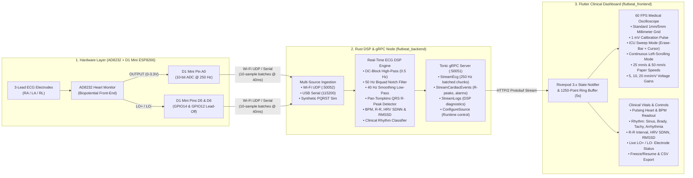

# ❤️ FlutBeat — Professional AD8232 ECG Telemetry & Clinical Oscilloscope

[](https://flutter.dev)
[](https://www.rust-lang.org/)
[](https://github.com/hyperium/tonic)
[](https://riverpod.dev/)
[](https://www.analog.com/en/products/ad8232.html)
[-005571.svg?logo=espressif)](https://www.wemos.cc/)
[](LICENSE)

**FlutBeat** is a clinical-grade, real-time Electrocardiogram (ECG) monitoring, Digital Signal Processing (DSP), and telemetry system. Electrical cardiac signals acquired by an **Analog Devices AD8232** front-end are sampled at **250 Hz** by a **WeMos D1 Mini (ESP8266)**, processed in real time by an asynchronous **Rust (`tonic` gRPC) DSP backend**, and streamed to a high-precision **Flutter (`Riverpod 3.x`)** clinical oscilloscope dashboard.

---

## 📑 Table of Contents

1. [System Architecture](#-system-architecture)
2. [Hardware Wiring & Pinout (AD8232 ↔ WeMos D1 Mini)](#-hardware-wiring--pinout)
3. [Einthoven 3-Lead Electrode Placement](#-einthoven-3-lead-electrode-placement)
4. [Digital Signal Processing (DSP) Pipeline](#-digital-signal-processing-dsp-pipeline)
5. [gRPC API Contract (`telemetry.proto`)](#-grpc-api-contract)
6. [Firmware Setup (WeMos D1 Mini ESP8266)](#-firmware-setup)
7. [Quickstart: Rust Backend & Simulator](#-quickstart-rust-backend--simulator)
8. [Quickstart: Flutter Clinical Dashboard](#-quickstart-flutter-clinical-dashboard)
9. [Terminal CLI Receiver](#-terminal-cli-receiver)
10. [Repository Structure](#-repository-structure)

---

## 🏗 System Architecture



---

## ⚡ Hardware Wiring & Pinout

The **WeMos D1 Mini (ESP8266)** includes an onboard `220kΩ / 100kΩ` resistor divider on pin `A0`, scaling its internal `0–1.0V` ADC range to **`0–3.2V` (10-bit resolution: `0–1023`)**. This matches the AD8232 analog `OUTPUT` voltage swing cleanly without requiring external resistors.

<p align="center">
  
</p>

### Connection Mapping Table

| AD8232 Pin | D1 Mini Pin | ESP8266 GPIO | Wire Color | Function & Electrical Specification |
|---|---|---|---|---|
| **`3.3V`** | **`3V3`** | 3.3V LDO Output | **Red** | Power supply (regulated 3.3V from D1 Mini) |
| **`GND`** | **`G`** | Ground | **Black** | Common system ground reference |
| **`OUTPUT`** | **`A0`** | `ADC0` | **Green** | Amplified & filtered analog cardiac signal (`0–3.2V`) |
| **`LO-`** | **`D6`** | `GPIO12` | **Yellow** | Lead-Off Detection Negative (`1` = disconnected, `0` = connected) |
| **`LO+`** | **`D5`** | `GPIO14` | **Orange** | Lead-Off Detection Positive (`1` = disconnected, `0` = connected) |
| **`SDN`** | **`D7`** | `GPIO13` | **Blue** | Shutdown control (Driven `HIGH` by D1 Mini to enable AD8232) |

---

## 🫀 Einthoven 3-Lead Electrode Placement

For standard **Lead II** monitoring (which yields the tallest, clearest R-peak deflection aligned with the primary ventricular depolarization vector):

<p align="center">
  
</p>

1. **RA (Right Arm — Red)**: Placed near the right shoulder, just beneath the right clavicle.
2. **LA (Left Arm — Yellow)**: Placed near the left shoulder, just beneath the left clavicle.
3. **RL (Right Leg — Green)**: Placed on the lower right abdomen or right lower ribcage (acts as the body ground reference to cancel 50/60 Hz common-mode noise).

$$\text{Lead II Potential} = V_{\text{LA}} - V_{\text{RA}}$$

---

## 🎛 Digital Signal Processing (DSP) Pipeline

The Rust DSP engine (`backend/src/dsp.rs`) processes samples at a strict **$f_s = 250\text{ Hz}$** ($T_s = 4\text{ ms}$):

1. **ADC to Millivolt Scaling**:
   Converts 10-bit raw ADC (`0..1023`, centered around baseline ~`512`) back to physiological surface millivolts through the AD8232 instrumentation and filter gain stage ($G \approx 1100\text{ V/V}$):
   $$\Delta V_{\text{physio}} = \frac{(\text{ADC} - 511.5) \cdot (3200\text{ mV} / 1023)}{1100} \approx -1.5\text{ mV} \dots +1.5\text{ mV}$$

2. **DC-Blocking High-Pass Filter ($f_c \approx 0.5\text{ Hz}$)**:
   $$y[n] = x[n] - x[n-1] + 0.992 \cdot y[n-1]$$
   Removes slow baseline wander caused by subject respiration and perspiration.

3. **50 Hz Biquad Notch Filter ($Q = 8$)**:
   Suppresses mains powerline hum and electrical interference.

4. **40 Hz Smoothing Low-Pass Filter**:
   Second-order Butterworth low-pass filter attenuating high-frequency electromyographic (EMG) muscle tremor noise.

5. **Pan-Tompkins QRS R-Peak Detector**:
   - 5-point derivative: $y[n] = \frac{1}{8} (2x[n] + x[n-1] - x[n-3] - 2x[n-4])$
   - Non-linear squaring operator: $y[n]^2$
   - Moving-Window Integration (MWI) over 30 samples ($120\text{ ms}$)
   - Adaptive dual-threshold tracking (signal peak vs. noise peak)
   - $200\text{ ms}$ refractory blanking period to prevent double-counting T waves.

6. **Cardiac Metrics & Rhythm Classification**:
   - Rolling **Heart Rate (BPM)** $= 60000 / \text{RR}_{\text{ms}}$
   - **HRV SDNN**: Standard deviation of all NN/RR intervals over 30 beats
   - **HRV RMSSD**: Root mean square of successive differences between adjacent RR intervals
   - Rhythm: `NORMAL SINUS` (60–100 BPM), `BRADYCARDIA` (< 60 BPM), `TACHYCARDIA` (> 100 BPM), `IRREGULAR ARRHYTHMIA` ($\text{SDNN} > 65\text{ ms}$), or `NO SIGNAL` (Lead-Off active).

---

## 📜 gRPC API Contract

The service definition is in [`backend/proto/telemetry.proto`](backend/proto/telemetry.proto) (mirrored in `frontend/proto/telemetry.proto`):

```protobuf
syntax = "proto3";
package telemetry.v1;

service TelemetryService {
  // High-frequency 250 Hz batched ECG waveform chunks
  rpc StreamEcg (StreamEcgRequest) returns (stream EcgWaveformChunk);

  // Discrete cardiac events (QRS R-peaks, Lead-Off alarms, rhythm switches)
  rpc StreamCardiacEvents (StreamEventsRequest) returns (stream CardiacEvent);

  // Diagnostic operational & DSP logs
  rpc StreamLogs (StreamLogsRequest) returns (stream LogEntry);

  // Status query snapshot
  rpc GetStatus (GetStatusRequest) returns (StatusResponse);

  // Switch between Hardware (UDP/Serial) and Synthetic Simulator at runtime
  rpc ConfigureSource (ConfigureSourceRequest) returns (StatusResponse);
}
```

---

## 🔌 Firmware Setup (WeMos D1 Mini ESP8266)

The firmware sketch is located at [`firmware/d1_mini_ecg/d1_mini_ecg.ino`](firmware/d1_mini_ecg/d1_mini_ecg.ino):

1. Open `firmware/d1_mini_ecg/d1_mini_ecg.ino` in the **Arduino IDE** or **VS Code (PlatformIO)**.
2. In the Board Manager, ensure **`esp8266 by ESP8266 Community`** is installed. Select board **`LOLIN(WEMOS) D1 R2 & mini`**.
3. Update your Wi-Fi credentials and target workstation IP:
   ```cpp
   const char* WIFI_SSID     = "YOUR_WIFI_SSID";
   const char* WIFI_PASSWORD = "YOUR_WIFI_PASSWORD";
   const char* TARGET_HOST_IP = "192.168.178.xx"; // IP of computer running `ecg_node`
   ```
4. Connect the D1 Mini via Micro-USB and click **Upload**.
5. The D1 Mini will sample pin `A0` at deterministic **250 Hz** ($4000\ \mu\text{s}$ interval) and transmit 10-sample batches over Wi-Fi UDP (port `50052`) while mirroring CSV data over USB Serial at `115200` baud.

---

## 🚀 Quickstart: Rust Backend & Simulator

The Rust backend includes a built-in **McSharry-inspired P-Q-R-S-T Synthetic ECG Simulator**, so you can develop, test, and demonstrate the full stack immediately even without hardware plugged in!

### 1. Build & Run the Backend Node
```bash
cd backend

# Run with built-in simulator test signal (default 72 BPM):
make test-signal

# Custom test signals:
make test-signal BPM=100
make test-signal-brady    # 48 BPM Bradycardia test
make test-signal-tachy    # 135 BPM Tachycardia test
make test-signal-leadoff  # Electrode disconnect alert test

# Or listen for real WeMos D1 Mini UDP packets on port 50052:
cargo run --bin ecg_node -- --mode udp
```

### 2. Available Make Commands
Run `make help` (from the repository root or inside `backend/`) to view all tasks:
```text
  test-signal            Run BE generating synthetic ECG test signal for FE (default: BPM=72, PORT=50051)
  test-signal-brady      Run BE test signal with Bradycardia (48 BPM) for FE alert testing
  test-signal-tachy      Run BE test signal with Tachycardia (135 BPM) for FE alert testing
  test-signal-leadoff    Run BE test signal with Lead-Off disconnect condition for FE alert testing
  send-test-signal       Stream UDP test signal packets into running BE (simulates WeMos D1 Mini)
  sim                    Alias for test-signal
  build                  Build debug binaries (ecg_node, ecg_receiver)
  build-release          Build optimized release binaries
  run-node               Run FlutBeat ECG gRPC server & simulator daemon
  run-receiver           Run terminal ECG oscilloscope & telemetry receiver
  check                  Fast compilation check
  test                   Run full unit and gRPC integration test suite
  clippy                 Run Clippy linter
```

---

## 📱 Quickstart: Flutter Clinical Dashboard

The Flutter application provides a 60 FPS medical oscilloscope on standard millimeter grid paper, responsive vital cards, clinical toolbar controls, and a collapsible cardiac event drawer.

```bash
cd frontend

# Install dependencies
flutter pub get

# Run static analysis & test suite
flutter analyze
flutter test

# Run application on macOS desktop, Chrome, iOS Simulator, or Android
flutter run
```

### Clinical Dashboard Features:
- **Medical Millimeter Grid**: Minor $1\text{ mm}$ grid ticks and major $5\text{ mm}$ squares ($0.20\text{ s} \times 0.5\text{ mV}$) with $1\text{ mV}$ calibration pulse.
- **Display Modes**:
  - **ICU Sweep Mode** (default): Glowing phosphor cursor sweeps left-to-right with a blanking erase bar.
  - **Continuous Scroll Mode**: Waveform scrolls smoothly from right to left.
- **Paper Speed & Gain**: Toggle between $25\text{ mm/s}$ & $50\text{ mm/s}$, and $5\text{ mm/mV}$, $10\text{ mm/mV}$, or $20\text{ mm/mV}$.
- **Pulsing Heart & Vitals**: Heart icon pulses synchronously with every detected QRS R-peak; displays real-time BPM, R-R intervals, HRV SDNN/RMSSD, and rhythm tags.
- **Electrode Status**: Live indicators for `LO+` (`D5`) and `LO-` (`D6`). Flashes a prominent warning banner if electrodes detach.
- **CSV Export**: One-click button copies all captured waveform points in the ring buffer directly to the clipboard.

---

## 🖥 Terminal CLI Receiver

To inspect the telemetry stream directly in the terminal with an ASCII/Unicode sparkline:

```bash
cd backend
cargo run --bin ecg_receiver -- --server-url http://127.0.0.1:50051
```

**Terminal Output Example:**
```text
=========================================================
   ❤️  FlutBeat — Live ECG Oscilloscope & Telemetry Receiver
   Server: http://127.0.0.1:50051 | Min Level: info
=========================================================

✓ Connected to http://127.0.0.1:50051

── Initial System Status ───────────────────────────────────
  Uptime: 2s | Mode: Simulator | Samples Processed: 520 | HR: 72 BPM
────────────────────────────────────────────────────────────

[#001] ❤️  BEEP | SIMULATOR   | HR:  72 BPM | RR:  833 ms | HRV: 38.2 ms | +1.42 mV | Trace:  ▂▃▄▅██▇▅▃▂ 
[#002] 🤍       | SIMULATOR   | HR:  72 BPM | RR:  833 ms | HRV: 38.2 ms | +0.28 mV | Trace: ▂▃▄▄▃▂     
[#003] 🤍       | SIMULATOR   | HR:  72 BPM | RR:  833 ms | HRV: 38.2 ms | +0.01 mV | Trace: ▂          
```

---

## 📁 Repository Structure

```text
flutbeat/
├── README.md                          # Unified master documentation
├── assets/
│   ├── ad8232_d1_mini_wiring.svg      # Vector wiring schematic (AD8232 <-> D1 Mini)
│   └── ecg_electrode_placement.svg    # Einthoven Lead II electrode placement diagram
├── firmware/
│   └── d1_mini_ecg/
│       └── d1_mini_ecg.ino            # Arduino C++ 250 Hz UDP/Serial firmware
├── backend/
│   ├── Cargo.toml                     # Rust manifest (tonic, prost, tokio, clap)
│   ├── Makefile                       # Build, run, test, and clippy targets
│   ├── build.rs                       # Tonic protoc compilation script
│   ├── proto/
│   │   └── telemetry.proto            # gRPC protocol buffer contract
│   ├── src/
│   │   ├── lib.rs                     # Library exports & timestamp formatters
│   │   ├── dsp.rs                     # DC block, 50Hz notch, 40Hz LP, Pan-Tompkins QRS, HRV
│   │   ├── simulator.rs               # Synthetic PQRST Gaussian morphology generator
│   │   ├── ingest.rs                  # Wi-Fi UDP :50052 & Serial parser
│   │   ├── server.rs                  # Shared state & Tonic TelemetryService implementation
│   │   └── bin/
│   │       ├── ecg_node.rs            # Server daemon (gRPC + UDP + Simulator)
│   │       └── ecg_receiver.rs        # Terminal CLI viewer & sparkline receiver
│   └── tests/
│       └── grpc_telemetry_test.rs     # Integration test suite for gRPC endpoints
└── frontend/
    ├── pubspec.yaml                   # Flutter manifest (Riverpod 3.x, grpc, protobuf)
    ├── proto/
    │   └── telemetry.proto            # Protobuf schema
    ├── lib/
    │   ├── main.dart                  # Clinical dark theme & ProviderScope entry
    │   └── src/
    │       ├── generated/             # Protobuf & gRPC Dart stubs
    │       ├── models/
    │       │   ├── connection_config.dart
    │       │   └── telemetry_state.dart
    │       ├── providers/
    │       │   ├── config_provider.dart
    │       │   ├── grpc_client_provider.dart
    │       │   └── telemetry_provider.dart
    │       └── ui/
    │           ├── screens/
    │           │   ├── dashboard_screen.dart
    │           │   └── config_screen.dart
    │           └── widgets/
    │               ├── blinking_heartbeat_dot.dart
    │               ├── clinical_vitals_bar.dart
    │               ├── ecg_control_toolbar.dart
    │               ├── ecg_oscilloscope_painter.dart
    │               └── event_log_list.dart
    └── test/
        └── widget_test.dart           # UI & widget test suite
```

