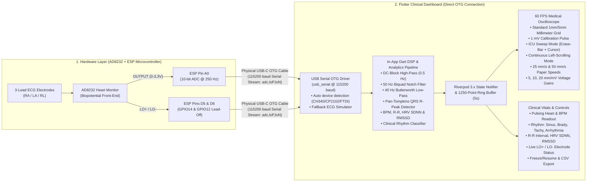
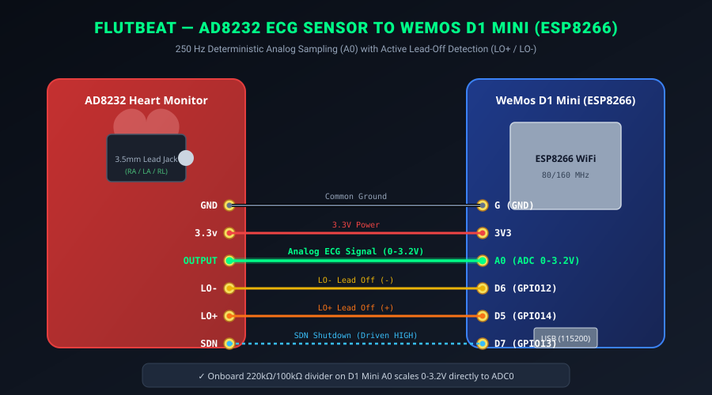
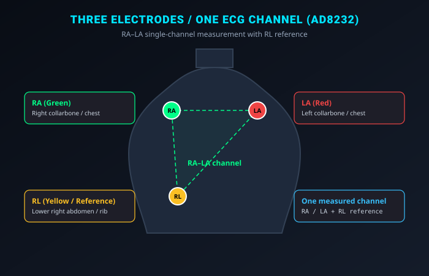

# ❤️ FlutBeat — Direct USB OTG ECG Telemetry & Clinical Oscilloscope

[](https://flutter.dev)
[-green.svg)](#-system-architecture)
[](https://riverpod.dev/)
[](https://www.analog.com/en/products/ad8232.html)
[_/_ESP32-005571.svg?logo=espressif)](https://www.wemos.cc/)
[](LICENSE)

**FlutBeat** is a clinical-grade, real-time Electrocardiogram (ECG) monitoring and telemetry system operating **directly between the ESP microcontroller and a Flutter mobile application via a physical USB-C OTG cable — requiring no backend server, no cloud, and no Wi-Fi network**.

Electrical cardiac biopotentials acquired by an **Analog Devices AD8232** front-end are sampled at **250 Hz** by the ESP microcontroller, streamed over high-speed USB Serial directly into Flutter, filtered and analyzed by an embedded **in-app Dart DSP & Pan-Tompkins QRS detection engine**, and rendered on a 60 FPS medical oscilloscope canvas.

---

## 📑 Table of Contents

1. [System Architecture](#-system-architecture)
2. [Required Electronics & Hardware Components (BOM)](#-required-electronics--hardware-components-bom)
3. [Circuit Schematics & Hardware Wiring](#-circuit-schematics--hardware-wiring)
4. [AD8232 Analog Front-End Circuit Architecture](#-ad8232-analog-front-end-circuit-architecture)
5. [Einthoven 3-Lead Electrode Placement](#-einthoven-3-lead-electrode-placement)
6. [In-App Digital Signal Processing (DSP) Pipeline](#-in-app-digital-signal-processing-dsp-pipeline)
7. [Firmware Setup (WeMos D1 Mini / ESP32)](#-firmware-setup)
8. [Quickstart: Flutter Clinical Dashboard](#-quickstart-flutter-clinical-dashboard)
9. [Repository Structure](#-repository-structure)

---

## 🏗 System Architecture



---

## 🧰 Required Electronics & Hardware Components (BOM)

To build the physical FlutBeat biopotential acquisition node, you will need the following electronic components:

| Item | Component | Specification | Description / Role |
| :---: | :--- | :--- | :--- |
| **1** | **Analog Devices AD8232 Breakout** | Single-Lead ECG Front-End Board | Instrumentation amp + Right Leg Drive (RLD) + high/low-pass filters ($\text{Gain} \approx 1100\text{ V/V}$). |
| **2** | **Microcontroller Board** | **WeMos D1 Mini (ESP8266)** or **ESP32 DevKit** | Samples analog cardiac signal at 250 Hz and streams CSV frames via UART/USB bridge. |
| **3** | **ECG Biomedical Cable** | 3-Lead Shielded Cable ($3.5\text{ mm}$ audio jack to button snaps) | Connects body electrodes to the AD8232 input jack with minimal electromagnetic induction. |
| **4** | **ECG Electrode Pads** | Pre-gelled $\text{Ag/AgCl}$ Disposable Electrodes (3 pads) | Medical-grade adhesive hydrogel pads ensuring low skin-contact impedance ($<5\text{ k}\Omega$). |
| **5** | **USB-C OTG Cable / Adapter** | USB-C Male to Micro-USB / USB-C Data Cable | Powers the microcontroller directly from the mobile phone ($5\text{V VBUS}$) and carries bidirectional Serial data. |
| **6** | **Jumper Wires** | Female-to-Female or Male-to-Female DuPont ($10\text{–}15\text{ cm}$) | Interconnects AD8232 breakout header pins to the ESP development board. |
| **7** | **Breadboard (Optional)** | Mini Solderless Prototype Breadboard ($170\text{–}400$ tie points) | Convenient for stable bench testing and prototyping. |

---

## ⚡ Circuit Schematics & Hardware Wiring

The **WeMos D1 Mini (ESP8266)** includes an onboard $220\text{ k}\Omega\ /\ 100\text{ k}\Omega$ resistor divider on pin `A0`, scaling its internal $0–1.0\text{ V}$ ADC range to **$0–3.2\text{ V}$ ($10$-bit resolution: $0–1023$)**. This matches the AD8232 analog `OUTPUT` voltage swing cleanly without requiring external resistors.

<p align="center">
  
</p>

### Connection Mapping Table

| AD8232 Pin | D1 Mini Pin | ESP8266 GPIO | Wire Color | Function & Electrical Specification |
|---|---|---|---|---|
| **`3.3V`** | **`3V3`** | 3.3V LDO Output | **Red** | Power supply (regulated $3.3\text{ V}$ from D1 Mini onboard regulator; $I_{DD} \approx 170\ \mu\text{A}$) |
| **`GND`** | **`G`** | Ground | **Black** | Common system ground reference |
| **`OUTPUT`** | **`A0`** | `ADC0` | **Green** | Amplified & filtered analog cardiac signal ($0–3.2\text{ V}$, centered around $1.65\text{ V}$ virtual ground) |
| **`LO-`** | **`D6`** | `GPIO12` | **Yellow** | Lead-Off Detection Negative ($1$ = disconnected, $0$ = connected; internal pull-up) |
| **`LO+`** | **`D5`** | `GPIO14` | **Orange** | Lead-Off Detection Positive ($1$ = disconnected, $0$ = connected; internal pull-up) |
| **`SDN`** | **`D7`** | `GPIO13` | **Blue** | Shutdown control (Driven `HIGH` by D1 Mini to enable AD8232 front-end amplifier) |

> [!NOTE]
> If using an **ESP32** instead of the D1 Mini:
> - Connect `OUTPUT` to `GPIO36` (ADC1 Channel 0, `VP`) or `GPIO34`.
> - Configure the ESP32 ADC attenuation to `ADC_ATTEN_DB_11` ($0\text{–}3.3\text{ V}$ input range).
> - Connect `LO+`, `LO-`, and `SDN` to any available digital GPIOs (e.g., `GPIO14`, `GPIO12`, `GPIO13`).

---

## 🔬 AD8232 Analog Front-End Circuit Architecture

The AD8232 is an integrated biopotential conditioning front-end specifically designed to extract, amplify, and filter small cardiac signals in the presence of noisy environments:

```
               +-------------------------------------------------------------+
               |                  AD8232 Analog Front-End                    |
               |                                                             |
   RA (Red) ---+---> [Instrumentation Amp] ----> [High-Pass Filter 0.5Hz]    |
               |      (Differential G=100)                      |            |
   LA (Yel) ---+------------+                                   v            |
               |            |                      [Sallen-Key Low-Pass 40Hz] |
   RL (Grn) <--+--- [Right Leg Drive (RLD)]               (G=11 V/V)         |
               |     (Common-Mode Feedback)                     |            |
               |                                                v            |
               |                                            [OUTPUT] --------+---> ESP ADC (A0)
               |                                                             |
               |   [Lead-Off Detectors (+ / -)] ------------> [LO+ / LO-] ---+---> ESP D5 / D6
               +-------------------------------------------------------------+
```

1. **Instrumentation Amplifier (INA Stage)**:
   - High Common-Mode Rejection Ratio ($\text{CMRR} > 80\text{ dB}$) rejects common-mode noise from powerlines and fluorescent lighting.
   - Internal instrumentation gain fixed at $G = 100\text{ V/V}$.
2. **Right Leg Drive (RLD) Inverting Amplifier**:
   - Detects the common-mode voltage on the patient's body through the RA and LA electrodes, inverts it, and drives it back through the RL (Right Leg) electrode.
   - Cancels 50/60 Hz electromagnetic pickup from ambient electrical wiring.
3. **High-Pass Filter ($0.5\text{ Hz}$)**:
   - Eliminates the large half-cell electrode offset potential ($> 300\text{ mV}$) created at the skin-gel interface, preventing amplifier saturation.
4. **Two-Pole Sallen-Key Low-Pass Filter ($40\text{ Hz}$)**:
   - Active low-pass filter stage with a gain of $11\text{ V/V}$.
   - Provides anti-aliasing prior to ADC sampling at 250 Hz.
   - **Total Analog Gain**: $G_{\text{total}} = 100 \times 11 = 1100\text{ V/V}$.
5. **Leads-Off Detection Comparators**:
   - Senses high impedance when an electrode pad falls off or loses skin contact.
   - Drives `LO+` or `LO-` lines `HIGH` to immediately warn the application.

---

## 🫀 Einthoven 3-Lead Electrode Placement

For standard **Lead II** monitoring (which yields the tallest, clearest R-peak deflection aligned with the primary ventricular depolarization vector):

<p align="center">
  
</p>

### Anatomical Placement Guide

| Electrode Pad | Body Placement Location | Clinical Function | Wire Color (Standard) |
| :---: | :--- | :--- | :---: |
| **RA** | Right Infraclavicular Fossa (just beneath the right clavicle) | Negative biopotential input | **Red** |
| **LA** | Left Infraclavicular Fossa (just beneath the left clavicle) | Ground / Reference | **Yellow** |
| **RL** | Lower Left Abdomen (above left hip bone) | Positive biopotential input (Lead II axis) | **Green / Black** |

$$\text{Lead II Potential} = V_{\text{LL}} - V_{\text{RA}}$$

> [!TIP]
> **Best Practices for Clean ECG Signals:**
> 1. Clean the skin with an alcohol wipe and let it dry before attaching the electrode pads.
> 2. Ensure firm adhesion to reduce motion artifacts.
> 3. Keep the subject relaxed and still during monitoring to prevent electromyographic (EMG) muscle noise.

---

## 💻 In-App Digital Signal Processing (DSP) Pipeline

The application processes raw ADC data at **250 Hz** ($T_s = 4.0\text{ ms}$) in pure Dart:

1. **Physical Voltage Scaling**:
   Converts 10-bit raw ADC ($0 \dots 1023$, centered around baseline $\approx 512$) to physiological millivolts ($-1.6\text{ mV} \dots +1.6\text{ mV}$):
   $$V_{\text{cardiac}} = \frac{(ADC - 512) \times \frac{3200\text{ mV}}{1023}}{\text{Gain}_{\text{AD8232}}} \quad (\text{Gain} = 1100\text{ V/V})$$

2. **DC Blocker ($0.5\text{ Hz}$ High-Pass)**:
   Eliminates baseline drift and respiration wander:
   $$y[n] = x[n] - x[n-1] + \alpha \cdot y[n-1] \quad (\alpha = 0.992)$$

3. **$50\text{ Hz}$ Biquad Notch Filter**:
   Attenuates AC mains electrical hum with high Q-factor ($Q = 8$).

4. **$40\text{ Hz}$ Butterworth Low-Pass Filter**:
   Suppresses high-frequency electromyographic (EMG) muscle noise and tremor.

5. **Pan-Tompkins QRS Detection Engine**:
   - 5-point derivative: $y[n] = \frac{2x[n] + x[n-1] - x[n-3] - 2x[n-4]}{8}$
   - Nonlinear squaring: $y[n]^2$
   - Moving-Window Integration (MWI) over $120\text{ ms}$ window ($30$ samples)
   - Dual adaptive thresholding ($0.25 \times (\text{Signal} - \text{Noise})$)
   - $200\text{ ms}$ refractory blanking period ($50$ samples)

6. **Cardiac Telemetry & HRV Calculation**:
   - R-R intervals and moving heart rate (BPM)
   - HRV metrics: **SDNN** and **RMSSD**
   - Rhythm classification: *Normal Sinus*, *Bradycardia* ($<60$), *Tachycardia* ($>100$), *Irregular Arrhythmia*, *No Signal*.

---

## ⚡ Firmware Setup (WeMos D1 Mini / ESP32)

The firmware sketch is located at [`firmware/d1_mini_ecg/d1_mini_ecg.ino`](firmware/d1_mini_ecg/d1_mini_ecg.ino):

1. Open `firmware/d1_mini_ecg/d1_mini_ecg.ino` in the **Arduino IDE** or **VS Code (PlatformIO)**.
2. Select your board (e.g., **LOLIN(WEMOS) D1 R2 & mini** or **ESP32 Dev Module**).
3. Connect your board via USB and click **Upload**.
4. The board immediately begins streaming CSV packets at **115200 baud** ($8\text{-N-}1$):
   ```text
   <adc>,<lo_plus>,<lo_minus>
   512,0,0
   ```

---

## 🚀 Quickstart: Flutter Clinical Dashboard

### 1. Requirements
- Flutter SDK (>= 3.13)
- Android device with USB-OTG support (or Android Emulator / macOS desktop with built-in simulator)

### 2. Run Tests & Analyzer
```bash
make test     # Runs DSP unit tests and UI widget tests
make analyze  # Runs Flutter static analysis
```

### 3. Launch Application
```bash
make fe-run   # Launches Flutter app
```

### 4. Connect via USB OTG
1. Plug the ESP board into your Android phone/tablet using a USB-C OTG adapter cable.
2. Open the FlutBeat app.
3. Tap the **Settings icon** in the top-right corner.
4. Tap **"Scan Ports"** — your connected USB-to-UART chip (CH340, CP2102, FTDI) will appear.
5. Tap **"Connect to ESP OTG"**!
*(Note: If you don't have physical hardware at hand, toggle **"ECG Simulator"** to run the built-in synthetic cardiac generator).*

---

## Recording and exporting sessions

Tap **Record** to capture up to 10 minutes plus the preceding five seconds of available ECG. Sessions use automatic timestamp names. The app records raw ADC, converted and filtered voltage, lead flags, R peaks, cardiac metrics, detected events, display settings, and system logs. **Freeze** holds the waveform while acquisition and recording continue. **Stop** saves the session to the local **Session library**.

Recording keeps the screen awake. USB disconnect, stream errors, connection changes, or moving the app into the background stop and save the current session. This version supports foreground recording; it does not run a background recording service.

Open a session in the library to select an exact start/end range and export:

- **CSV:** choose the signal, metric, event, display, and log columns to include. Each row identifies its type; log rows have empty signal columns.
- **PDF:** a summary and up to three six-second ECG excerpts from the selected range, with either filtered or unfiltered voltage. Printed strip scale is 25 mm/s and 10 mm/mV at 100% print size.
- **Save file** opens Android's system destination picker; **Share** opens the platform share sheet. Export choices leave the complete local recording intact. CSV and PDF exports read the recording in batches without loading the full session into the UI.

Waveform offsets use sample order at the firmware's nominal **250 Hz**. The USB protocol has no acquisition timestamp or sequence counter, so exported UTC times describe arrival at the phone; missing firmware/USB samples cannot be identified from this protocol. The PDF labels this timing basis and shows lead-off intervals as gaps.

Sessions are stored under the app's support directory as versioned metadata and one-second batches of newline-delimited JSON. Batches are committed with atomic renames. After an app interruption, opening an unfinished session recovers its committed samples; the last uncommitted batch may be absent. Storage failures stop recording and retain pending data in memory for **Retry save**. Keep the app open until retry succeeds. Deleting a session requires confirmation in the library.

## 📂 Repository Structure

```text
flutbeat/
├── README.md                          # Master documentation & circuit schematics
├── assets/
│   ├── ad8232_d1_mini_wiring.svg      # Vector wiring schematic (AD8232 <-> D1 Mini)
│   └── ecg_electrode_placement.svg    # Einthoven Lead II electrode placement diagram
├── firmware/
│   └── d1_mini_ecg/
│       └── d1_mini_ecg.ino            # Direct USB Serial OTG 250 Hz firmware
├── frontend/
│   ├── android/                       # Android native project with USB host permissions
│   ├── lib/
│   │   ├── main.dart                  # App entry point & Riverpod Scope
│   │   ├── dashboard.dart             # Export barrel
│   │   └── src/
│   │       ├── dsp/                   # In-app DSP pipeline, filters & ECG simulator
│   │       │   ├── ecg_dsp_pipeline.dart
│   │       │   └── ecg_simulator.dart
│   │       ├── models/                # Cardiac metrics, events, state & config
│   │       │   ├── cardiac_metrics.dart
│   │       │   ├── connection_config.dart
│   │       │   └── telemetry_state.dart
│   │       ├── providers/             # Riverpod 3.x telemetry & config state notifiers
│   │       │   ├── config_provider.dart
│   │       │   └── telemetry_provider.dart
│   │       ├── services/              # USB Serial OTG device manager & parser
│   │       │   └── usb_serial_service.dart
│   │       └── ui/                    # Clinical screens & oscilloscope widgets
│   │           ├── screens/
│   │           │   ├── dashboard_screen.dart
│   │           │   └── config_screen.dart
│   │           └── widgets/
│   │               ├── blinking_heartbeat_dot.dart
│   │               ├── clinical_vitals_bar.dart
│   │               ├── ecg_control_toolbar.dart
│   │               ├── ecg_oscilloscope_painter.dart
│   │               └── event_log_list.dart
│   ├── test/
│   │   └── widget_test.dart           # Full unit & UI widget test suite
│   └── pubspec.yaml                   # Direct dependencies (no gRPC/protobuf/backend)
└── Makefile                           # Root commands (test, analyze, fe-run, build-apk)
```

---

## 📜 License
MIT License.
